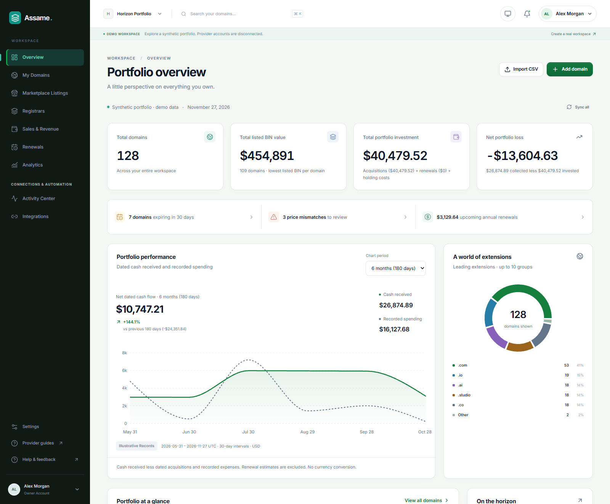

# Domain portfolio web app

Manage domain inventory, registrar and marketplace records, renewals, sales, and costs in a browser. The app supports multiple workspaces, CSV import and export, financial reporting, and optional provider synchronization.

The web app uses Next.js, React, TypeScript, Prisma, and PostgreSQL. A separate worker handles synchronization, background jobs, and email.



## Run locally

Install Node.js 22 and npm, plus Docker Engine with the Compose plugin or Docker Desktop. Use a fresh PostgreSQL database for this release. If you are reusing a checkout, configure its local environment for the new database before applying migrations.

Run these commands from the repository root:

```sh
npm run setup:env
npm ci
docker compose up -d --wait db
npm run db:migrate
npm run db:seed
npm run dev
```

Open [http://localhost:3010](http://localhost:3010). Sign in with **demo@assame.local** and **AssameDemo!2026**. These are local demo credentials. The seed creates a synthetic portfolio when `DEMO_MODE=true` in development. Use [the sample CSV](public/sample-domains.csv) to try imports.

Run `npm run worker` in a second terminal to enable background jobs. You can also use `npm run dev:all` to launch the web server and worker together after starting PostgreSQL and applying migrations.

`npm run setup:env` creates an ignored `.env` with fresh database, authentication, and credential-encryption secrets. It preserves an existing file. If port 5432 is in use, set a free port in both `POSTGRES_PORT` and `DATABASE_URL` in `.env` before starting the database. If you change the web port, start Next.js on the new port and update `AUTH_URL` to match.

## Configure an instance

### Create an account from the terminal

After configuring the database and applying migrations, the instance operator can create a personal account with its own empty workspace:

```sh
npm run account:create -- --email you@example.com --name "Your name" --workspace "My portfolio"
```

Enter a password of 12–128 characters at the hidden prompt. Sign in through the normal login page using that email and password. The command records the account as verified and requires no SMTP, Google or Discord setup. An existing email is rejected. For automation, use `--password-stdin` and provide the password through standard input from your secret manager.

The command uses `DATABASE_URL` from your environment or `.env`. Anyone running it needs access to that database. For an instance using terminal-created accounts, leave `SMTP_HOST`, `SMTP_FROM`, `SMTP_USER` and `SMTP_PASSWORD` empty and set `WELCOME_EMAILS_ENABLED=false`. This also works in production. Email verification, password recovery and email notifications require SMTP when used. Public registration continues to require email configuration.

### Deployment settings

See [`.env.example`](.env.example) for supported settings. Keep `.env`, database backups, private keys, and provider tokens outside version control. Configure the web and worker processes with the same database URL and credential-encryption key.

| Setting                     | Purpose                                                                                                                                       |
| --------------------------- | --------------------------------------------------------------------------------------------------------------------------------------------- |
| `AUTH_URL`                  | Your instance's origin. Use the same HTTPS origin at build and runtime for a public deployment.                                               |
| `AUTH_SECRET`               | Unique secret for authentication and sessions.                                                                                                |
| `CREDENTIAL_ENCRYPTION_KEY` | Random 32-byte key encoded as 64 hexadecimal characters. Store it securely. Existing provider connections depend on this key.                 |
| `DATABASE_URL`              | PostgreSQL connection string. Use a private, backed-up PostgreSQL instance for production.                                                    |
| `SMTP_*`                    | Optional mail service for verification, recovery and notifications. When configured in production, also enable `WELCOME_EMAILS_ENABLED=true`. |
| `DEMO_MODE`                 | Set to `false` in production and use a fresh production database.                                                                             |

For a deployment, apply the bundled migrations with `npm run db:migrate` using a database role that can install `pg_trgm`. Run the seed with demo mode disabled. Set the deployment configuration, run `npm run build`, and run the web server and worker as separate processes. The included Dockerfile builds images for both. Use an HTTPS reverse proxy and limit network access to the database and administrator interfaces. Review the site name, policy pages, and email sender for your own instance before inviting users.

Provider accounts, OAuth and analytics each require your own configuration. Provider writes are disabled in the example configuration. Provider synchronization runs on the server, which stores provider credentials encrypted and uses them to make authorized requests. Check the provider's API terms and your account permissions before enabling an integration. Provider names identify compatible services.

## Development

```sh
npm run lint
npm run typecheck
npm test
npm run build
```

Database integration tests use a disposable database with both `DATABASE_URL` and `TEST_DATABASE_URL` set to the same connection string. Apply migrations and seed that database before the test run. Browser tests also require a matching loopback `AUTH_URL` and `PLAYWRIGHT_BASE_URL` and a local SMTP fixture. The [CI workflow](.github/workflows/ci.yml) shows the fixture settings.

## License

The web app is available under the [MIT License](LICENSE). See the [third-party notices](THIRD_PARTY_NOTICES.md) for bundled assets.

## Donations

Optional donations are welcome. [Support the project via PayPal](https://paypal.me/pvperskal).
